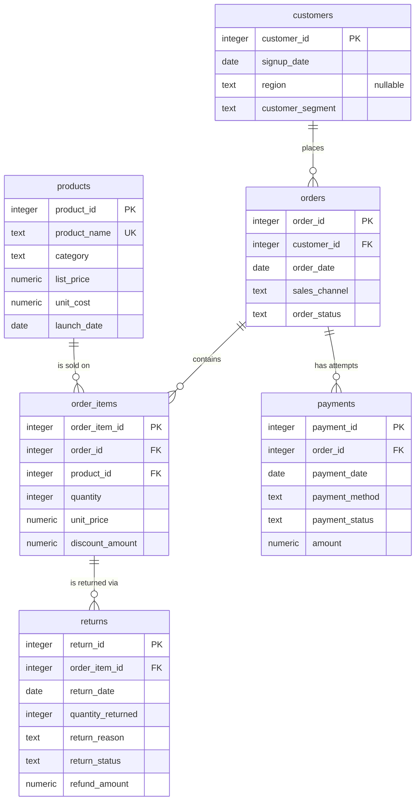

# Entity-Relationship Diagram

This diagram matches `sql/01_create_schema.sql`. GitHub renders Mermaid
diagrams automatically.

## Reading the relationships

- A customer can have zero or many orders (some customers never order).
- An order should have at least one line, but the schema allows zero so that
  the data-quality checks can detect orders that lost their lines.
- An order can have several payment attempts, for example a failed attempt
  followed by a captured one.
- Returns attach to an order line, not an order, because customers return
  specific products and sometimes only some of the units.
- `(order_id, product_id)` is unique in `order_items`: a product appears once
  per order, and `quantity` records multiples.

## Join paths used in the analysis

| From | To | Join |
|---|---|---|
| orders | customers | `orders.customer_id = customers.customer_id` |
| order_items | orders | `order_items.order_id = orders.order_id` |
| order_items | products | `order_items.product_id = products.product_id` |
| payments | orders | `payments.order_id = orders.order_id` |
| returns | order_items | `returns.order_item_id = order_items.order_item_id` |
| returns | orders | via `order_items` |
